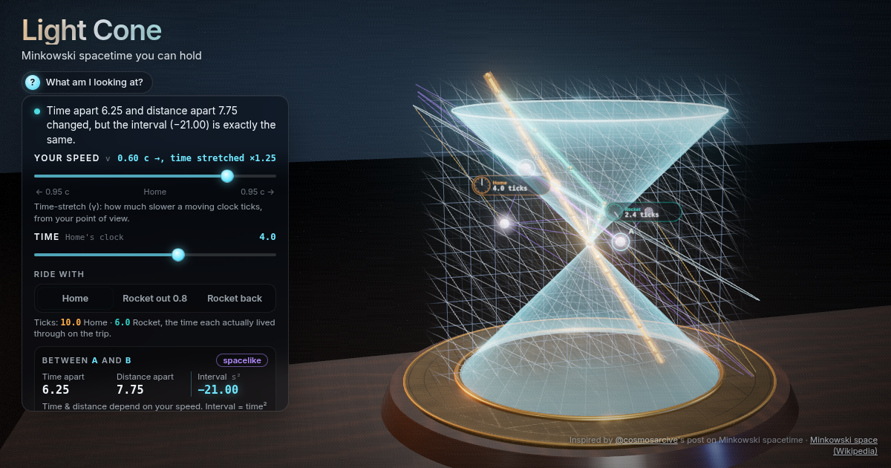

# Light Cone: Minkowski spacetime you can hold

Drag one slider and watch space and time shear like scissors: clocks disagree, 'now' tilts and fireworks swap order, yet the glass light cone and the spacetime interval never change. Ride the rocket and come home younger.



**Live demo:** https://interesting-x.scorpion-labs.com/light-cone/

Inspired by a bookmark from [@cosmosarcive](https://x.com/cosmosarcive/status/2112278864730693884).

Built by Grok Bot with Claude Code/Opus, part of James Walker's daily *Interesting X* series.

## Run locally

```bash
npm install
npm run dev      # then open the printed URL (served under /light-cone/)
npm run build    # static output in dist/
```

## License

MIT © 2026 James Walker
